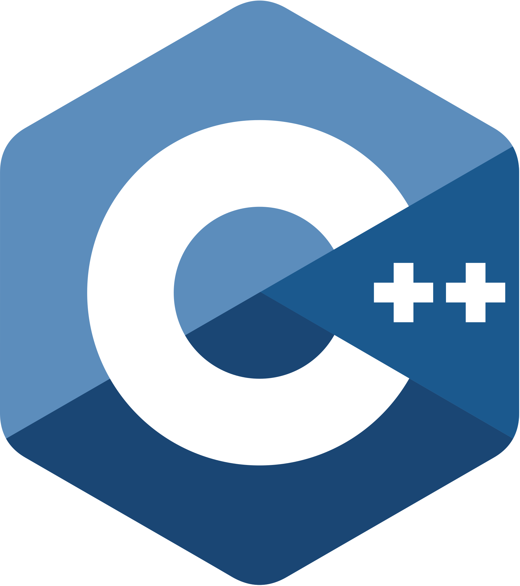
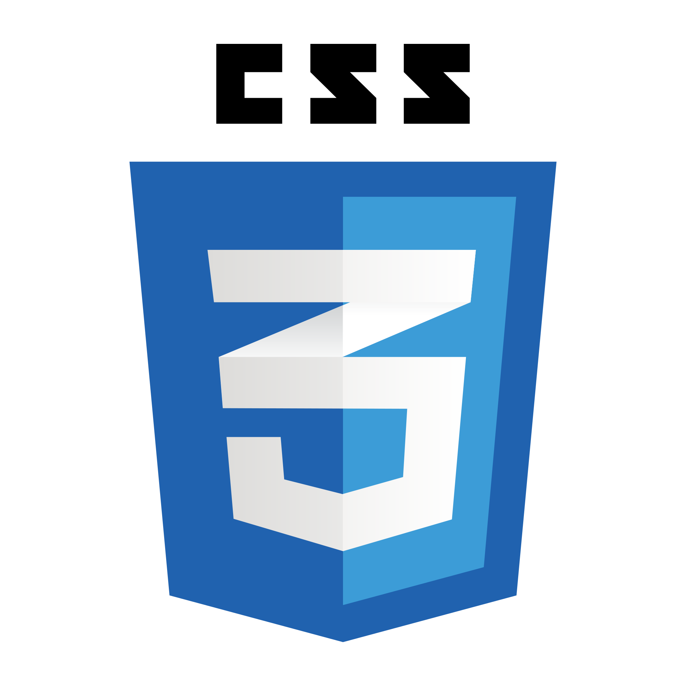
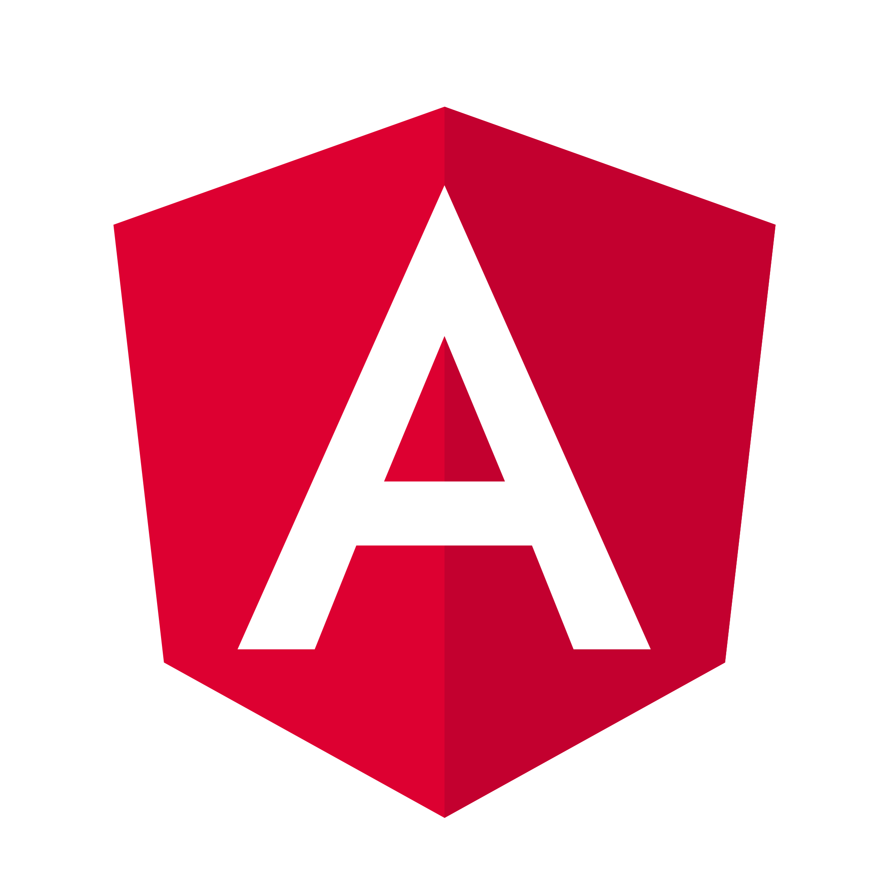
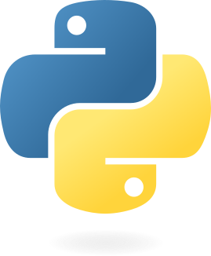
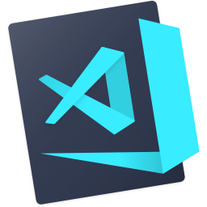
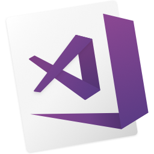
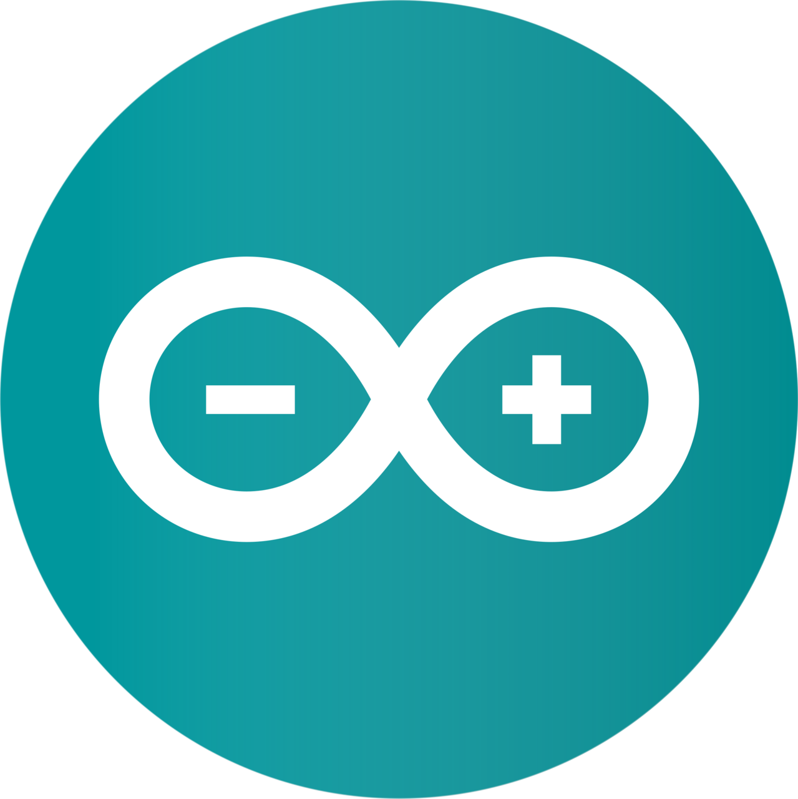
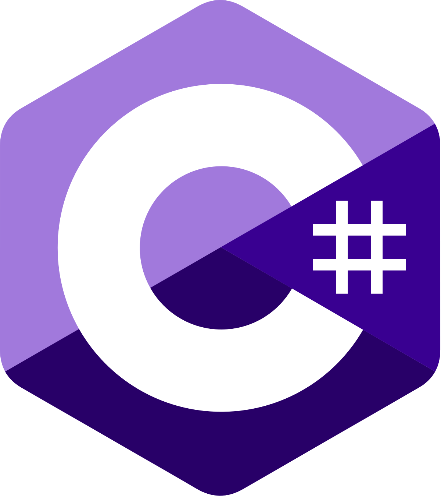

    Hello there! I'm Gabriel, a recent UF Computer Science graduate who just finished his Master's program. I have experience in security, computational geometry, and programming language translation work.

# 🔧 What I'm Up To

**I'm Currently...**

1. `Perfomring minor updates to ngx-loom, so that version 1.0.0 can be published soon.`
2. `Creating a soon to be open source repository of Obsidian notes from my time at UF.`
3. `Preparing CTF challenges for SwampCTF 2026.`
4. `Working on a Unity roguelike card battler game for fun, with hopes of releasing it on Steam someday.`

**My Future Plans Include...**

1. `Preparing my custom gravity asset to be uploaded to the Unity Asset Store.`

# 🎯 Technical Skill Set

    <code></code>
    <code></code>
    <code></code>
    <code></code>
    <code></code>
    <code></code>
    <code></code>
     
    <code></code>
    <code></code>
    <code></code>
    <code></code>
    <code></code>
    <code></code>
    <code></code>
    <code></code>

# 👨‍💻 Technologies I'm Learning

    <code></code>
    <code></code>

# 📊 GitHub Stats

|  |  |
| ------------- | ------------- |

# 📫 Connect With Me

    <code></code>

